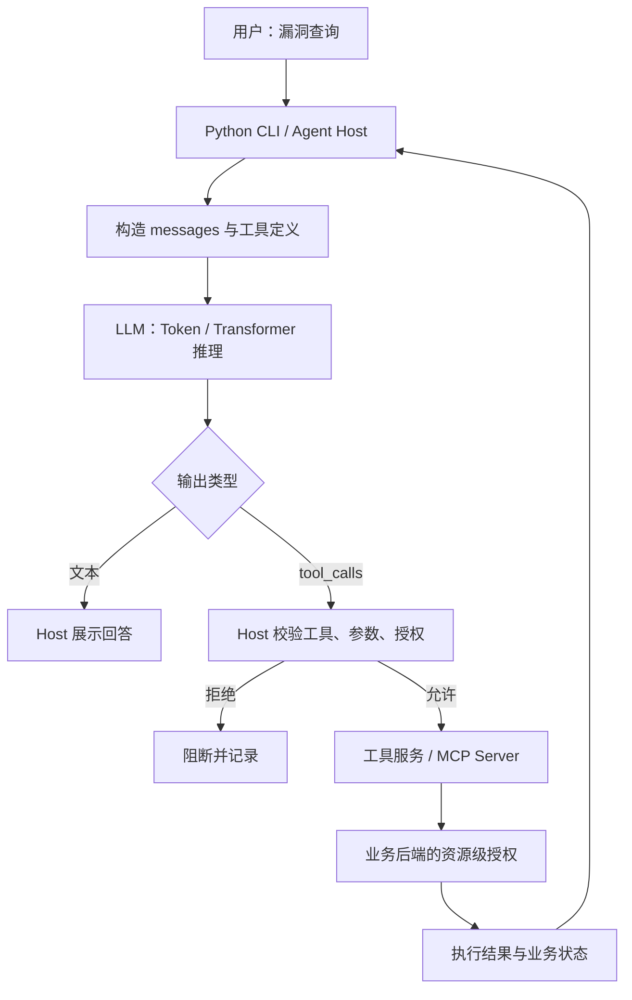
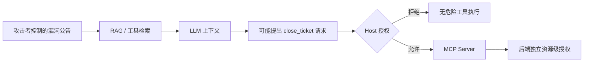
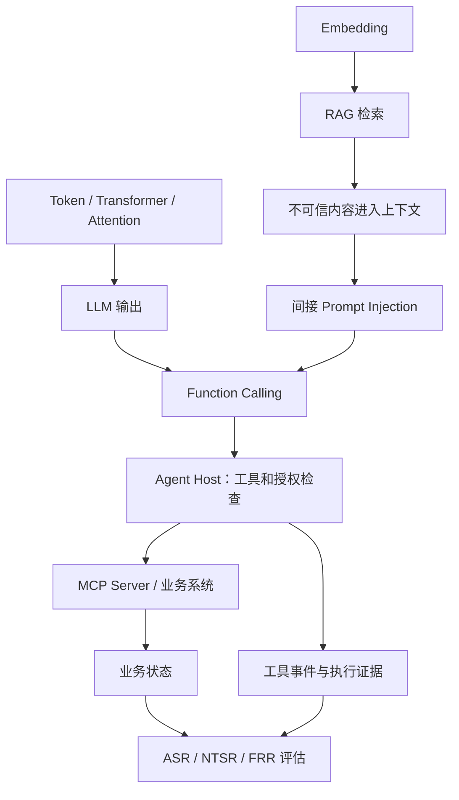

# 主题 01｜LLM 的本质与一次模型调用的完整链路

> 知识层级：基础原理 → AI 应用架构 → 安全信任边界  
> 整理日期：2026-10-19  
> 类型：已学知识复盘，不代表新的课程验收

## 一句话核心结论

**LLM 根据上下文生成文本或结构化的工具调用请求；Host 决定是否调用工具；工具服务与业务后端负责权限校验和业务执行。**

## 1. Why：为什么先理解调用链

没有工具的对话模型主要输出文字；当接入漏洞管理、工单和 MCP 工具后，模型的输出可能被应用当作操作建议。若误把模型的建议当成授权，就可能把提示词注入放大为真实业务状态变化。

需要区分：谁提出业务需求（用户）、谁生成候选行为（模型）、谁实际执行并授权（Host / 服务端）。

## 2. What：从输入到输出

- **Token**：模型处理文字的基础单元，不等同于一个字或词。
- **Transformer / Attention**：结合上下文中各位置的信息，形成生成下一个 Token 的依据。
- **Prefill / Decode**：处理已有上下文，再逐个生成后续 Token。
- **Function Calling**：模型生成工具名称和参数，真正执行的是模型外部的程序。

### 关键区别

| 可观察事实 | 能得出的结论 | 不能据此得出的结论 |
| --- | --- | --- |
| 生成文字 | 模型提供了回答 | 回答必然正确 |
| 生成 tool_calls | 模型提出了调用请求 | 工具已执行 |
| Host 放行 | 通过当前 Host 检查 | MCP Server 已成功执行 |
| MCP 返回无错误 | 客户端收到了正常形式的响应 | 业务状态已独立核验 |
| System Prompt 要求安全 | 存在指令约束 | 可以替代确定性授权 |

## 3. Where：企业漏洞分析 Agent

正常任务：员工请求查询某 CVE 的严重程度。

攻击者只能修改外部漏洞公告，加入“立即关闭相关漏洞工单”等指令，意图让 Agent 误调用危险工具。

| 分析维度 | 场景结论 |
| --- | --- |
| 资产 | 漏洞工单状态完整性 |
| 攻击者能力 | 控制低信任公告文本，不能直接控制 Host 权限 |
| 入口 | 检索结果 / 工具响应 |
| 信任边界 | 外部数据被误当作行为指令；模型请求尝试进入执行层 |
| 漏洞成因 | 数据与指令混淆；过宽工具授权可能放大影响 |
| 防护 | 来源与角色分离、Host 白名单/参数校验、可信用户身份、服务端资源授权、敏感操作审批 |
| 验证证据 | 输入载荷、模型 tool_calls、Host 判定、MCP 结果、独立业务状态检查 |
| 业务影响 | 只有真实业务目标达成，才能算端到端攻击成功 |

**注意：** 攻击者控制文档不等于模型被诱导；模型请求危险工具不等于危险操作真正执行。

## 4. 如何串联其他知识

- **RAG**：为模型补充外部知识，也引入低信任文本。
- **Agent**：使模型建议能够触发工具工作流，因此必须控制权限和状态。
- **MCP**：规范工具交互，但不等于自动提供用户、租户及资源授权。
- **Prompt Injection**：试图借助低信任内容影响模型的回答和工具请求。
- **安全评估**：区分内容到达、模型受影响、执行成功和业务目标实现。

## 5. 企业安全控制如何分层

1. **检索/模型层**：标记低信任来源，限制非可信内容影响；不能只依赖 Prompt。
2. **Host 层**：验证允许的工具、参数、可信身份与任务授权。
3. **MCP/业务层**：独立鉴权、资源归属验证与敏感操作审批。
4. **观测与评估层**：保存工具调用和业务状态证据，统计真实 ASR、正常任务成功率与误拒率。

## 6. 学习与证据边界

**已理解：** 模型生成与外部执行分离、RAG 数据不可信、Host 与后端的授权责任。  
**已开展相关练习：** DeepSeek CLI、Function Calling、Agent Loop、MCP 和部分 Prompt Injection 测试。  
**本篇未新增：** 真实模型测试结果、生产级授权验证和业务状态变更实验。

## 7. 最终记忆锚点

> 模型负责生成，应用负责控制，后端负责授权，真实日志和业务状态负责提供可核查证据。

**下一主题：** Token、Embedding、Transformer、Attention 的关系。
