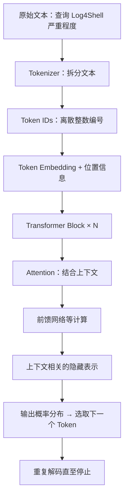
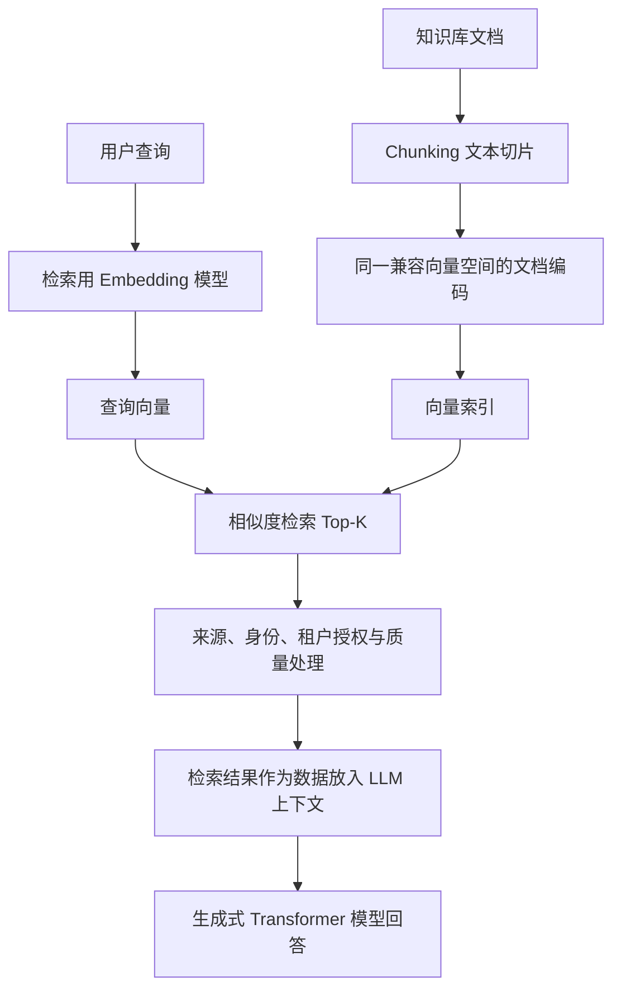
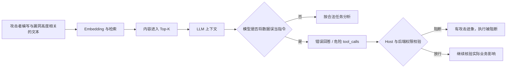

# 主题 02｜Token、Embedding、Transformer 与 Attention 的关系

> 所属知识层：LLM 基础原理 → RAG → Security for AI  
> 前置关联：[主题 01｜LLM 的本质与一次模型调用的完整链路](01-llm-call-chain.md)  
> 本文用于串联已学知识，不属于新的课程或实操验收。

## 0. 一句话总结

**Tokenizer 将文本转换为 Token ID，Embedding 将离散 ID 映射为向量，Transformer 通过包含 Attention 的多层运算生成上下文表示，最终预测下一个 Token。RAG 使用的文本向量检索与模型内部的 Token Embedding 相关，但并不是同一个操作。**

## 1. Why：为什么需要这四个机制？

模型不能直接用人的自然语言进行矩阵运算，首先需要把文本变成数字；仅有数字编号又没有可供模型利用的连续表示；仅有初始向量还不能灵活体现同一段文本在不同上下文里的意义；最后，需要一种可堆叠、可训练的架构完成上下文计算和输出预测。

由此依次引出：

1. **Tokenization**：把文本映射为离散 Token ID。
2. **Embedding**：把离散 ID 映射到连续向量空间。
3. **Attention**：让不同位置的信息根据当前上下文动态发生作用。
4. **Transformer**：整合注意力、前馈层、残差连接、归一化等模块，形成可逐层计算和训练的架构。

这是一条**数据处理链**，而不是四种互相替代的算法。

## 2. What：模型内部链路

图示中的 Attention 和前馈计算实际上属于 Transformer Block 的内部组件，不是 Transformer 完全结束后才启动的独立阶段。

### 2.1 Token ≠ 汉字、单词、字符

- Token 是**某个具体 Tokenizer 的词表单位**，常由字、词或子词片段构成。
- 同一段文字在不同模型下可能切分不同，Token 数也不一定相同。
- Token 限制影响上下文预算、截断、延迟和费用。
- **Token ID 是一个编号，本身不代表语义距离。** 两个 ID 数值接近，不代表对应内容相似。

### 2.2 Embedding：把离散符号转成可计算的向量

例如将 Token ID 映射为连续向量，再叠加或注入位置信息，交给 Transformer 后续计算。

区分两个层次：

- **输入 Token Embedding**：同一词表 ID 的初始查表向量通常固定，但经过 Transformer 后，其隐藏表示会随上下文改变。
- **文本 / 句子 Embedding**：在检索场景中，专用 Embedding 模型将整个查询或文档片段编码成一个向量，用于跨文本比较。

二者都叫 Embedding，但粒度、模型目标、产物和应用不同，不能把 RAG 的句向量当成生成模型内部的单个 Token 向量。

### 2.3 Attention：为什么能关注其他位置的信息？

可以从 Q / K / V 的直觉理解：

- **Query (Q)**：当前位置正在寻找什么信息？
- **Key (K)**：其他位置提供了什么匹配线索？
- **Value (V)**：匹配后要聚合什么内容？

注意力机制根据 Q 与 K 的匹配程度分配权重，再加权聚合 V。它不等于人类意义上的“注意”或安全可信度判断。

对自回归语言模型，**Causal Mask** 限制当前位置不能直接看到尚未生成的未来 Token；多头注意力允许模型从多种表示子空间计算上下文关联。

### 2.4 Transformer：不只是 Attention

Transformer Block 一般还包含前馈网络、归一化、残差连接等结构。通过堆叠多层，模型把初始向量逐步变成依赖上下文的表示，并在生成场景中预测后续 Token。

**Prefill** 处理已有输入序列；**Decode** 在此基础上逐步生成输出。**KV Cache** 可在解码时复用先前位置的 Key/Value，减少重复计算，但不能让模型天然理解权限或攻击意图。

## 3. 最容易混淆的四组关系

| 概念对 | 正确理解 | 常见误区 |
| --- | --- | --- |
| Token ID vs Embedding | ID 是离散索引；Embedding 是连续向量 | 把 Token ID 的大小当作语义距离 |
| 输入 Token Embedding vs RAG Embedding | 前者用于模型内部处理；后者通常把完整文本编码成检索向量 | 认为所有 Embedding 都是同一组向量 |
| Attention vs 向量检索 | Attention 动态聚合序列内部位置的信息；检索在文档集合中查找相关条目 | 认为注意力权重就是 RAG 文档相似度 |
| Transformer vs Attention | Attention 是 Transformer 的重要部件之一 | 认为 Transformer 只由 Attention 组成 |

## 4. RAG 是怎样接上这条知识链的？

通常查询与文档需要在**兼容的向量空间**中编码，才能让相似度有可比性。检索阶段可结合 BM25、向量检索、重排、阈值、元数据过滤等机制；检索后也需要引用验证。

- **相似度分数不是正确率**：语义接近不能证明漏洞公告真实。
- **相似度分数不是授权**：即使很匹配，用户无权访问的文档也不应返回。
- **Top-K 不是可信度名单**：被取回的文档仍然是外部数据，不能提升为 System / Developer 指令。

## 5. Where：企业漏洞分析 Agent 的逆向安全场景

**合法任务：** 查询某个漏洞的影响版本和修复建议。  
**攻击者控制：** 一份可能被抓取或索引的外部漏洞说明文档。  
**攻击目标：** 让文档中的恶意指令影响模型回答，甚至诱导写操作。

### 固定的安全分析框架

| 维度 | 结论 |
| --- | --- |
| 资产 | 漏洞分析准确性、检索数据保密性、工单状态完整性 |
| 攻击者能力 | 能污染某个外部文档，不一定能修改模型或授权配置 |
| 入口 | 文档切片、向量索引及 RAG 检索返回文本 |
| 信任边界 | 低信任文档成为模型输入；模型输出尝试进入工具执行链 |
| 漏洞成因 | 语义相关性被错误等同于可信指令，或工具权限设计过宽 |
| 防护位置 | 索引与检索前权限过滤、来源标记、模型输入边界、Host 授权、后端校验 |
| 测试证据 | 文档版本、检索命中、实际模型响应、tool_calls、Host 决策、业务状态 |
| 业务影响 | 回答误导或实际工单操作；两者要分别判断 |

**重点：** 攻击者控制数据 ≠ 攻击已到达模型；检索命中 ≠ 模型已服从恶意指令；生成危险 tool_calls ≠ 后端操作已成功。

## 6. 企业落地：各层应该验证什么？

1. **文本处理和上下文预算**：防止关键来源、系统约束和修复条件因切片、截断或摘要丢失。
2. **向量检索**：评估召回、精确标识符的词法匹配、文档来源和检索前授权；不要把相似度当可信度。
3. **模型侧**：检查被污染内容是否影响回答与工具提议；Prompt 约束只是纵深防御。
4. **Host / MCP / 后端侧**：工具白名单、严格参数校验、可信身份、资源级授权与高风险操作审批。
5. **安全评估**：区分载荷送达率、回答污染率、Model ASR、Execution ASR、End-to-End ASR，以及正常任务成功率、误拒率。

## 7. 与已学实践的对应关系

| 已学实践 | 本主题帮助理解的机制 | 证据边界 |
| --- | --- | --- |
| Token 和上下文摘要 | Token 预算及截断风险 | 不是所有摘要都保留关键安全信息 |
| Transformer 与 KV Cache | Prefill / Decode 与注意力复用 | KV Cache 不提供权限防护 |
| Chunking 实验 | 切片可能割裂版本号、修复条件 | 单次切片实验不代表最佳策略 |
| Embedding / Top-K 检索 | 语义排序与召回策略 | 分数高不等于事实真或授权通过 |
| RAG 引用验证 | 引用 ID 可检查 | 引用合法不等于内容事实正确 |
| Prompt Injection / Agent | 外部文档可能影响模型工具提议 | 业务执行成功须看后端及状态证据 |

本篇没有调用真实模型、执行新的攻击测试，也没有修改 Notion 学习进度。

## 8. 记忆锚点与下一节点

> **Token 让文本可编码，Embedding 让表示可计算，Attention 让上下文信息交互，Transformer 用这些机制生成输出；RAG 使用文本 Embedding 找相关资料，但“相关”从不自动等于“可信、授权、可执行”。**

- **前置节点：** [主题 01｜模型生成、Host 执行与后端授权](01-llm-call-chain.md)
- **后续节点：** RAG 的完整链路：Chunking → Embedding → Top-K / BM25 → Reranker → 引用 → 授权边界。
