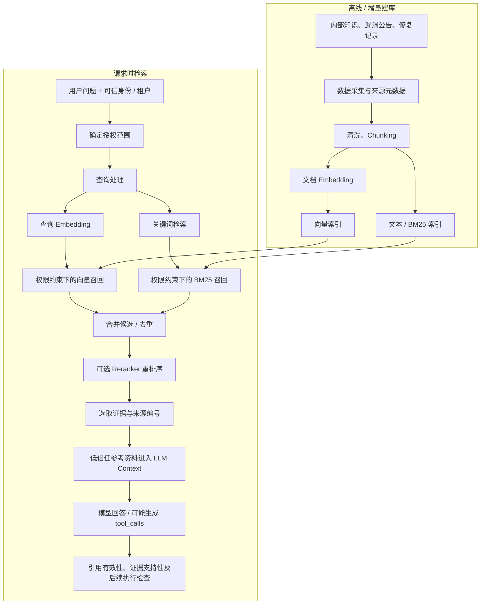
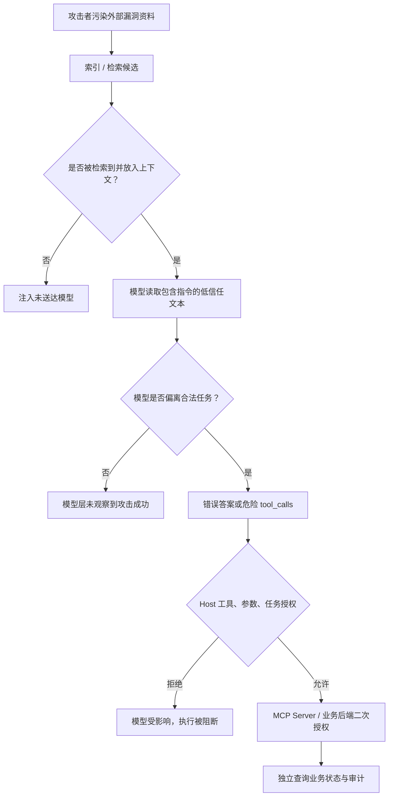
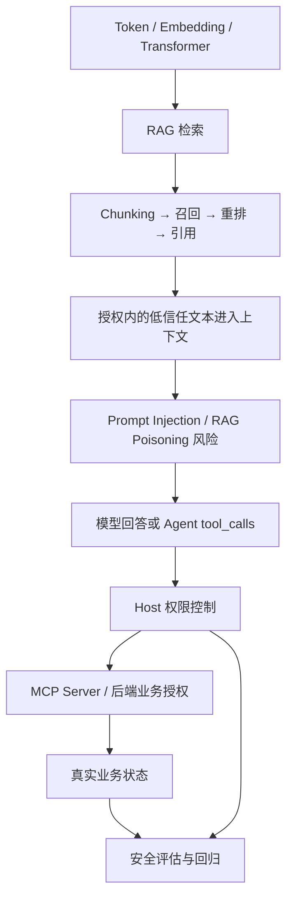

# 主题 03｜RAG 的完整知识链路与安全边界

> **学习定位：** LLM 基础 → RAG 语义检索 → 数据信任边界 → Prompt Injection / RAG Poisoning → Agent 执行安全  
> **本篇性质：** 串联既有知识；不构成新的实验结果或课程验收。  
> **前置主题：** [01｜模型生成与 Host 执行](../01-LLM-Basics/01-llm-call-chain.md) · [02｜Token、Embedding、Transformer 与 Attention](../01-LLM-Basics/02-token-embedding-transformer-attention.md)

## 0. 一句话结论

**RAG 的任务是找到并提供与用户问题相关的外部知识，而不是给外部内容赋予事实可信度、身份权限或行为指令优先级。**

贯穿全文的四个“不等于”：

> **相关性 ≠ 正确性 ≠ 访问授权 ≠ 指令权限。**

## 1. Why：为什么需要 RAG？

生成式 LLM 的模型参数不会随着企业资产清单、内部漏洞处置工单、最新公告自动更新。将这些资料全部塞进每次上下文也会产生长度、成本、噪声以及权限控制问题。

RAG 的基本思路是：**回答前根据问题寻找相关材料，再把材料作为参考证据放入上下文。**

它通常比频繁重新训练模型更适合接入持续更新的外部知识，但依然需要面对检索质量、权限、数据投毒、提示词注入以及引用可信度等问题。

RAG 解决的是“资料从哪里来、怎样提供给模型”，不能替代源头真实性核验、确定性权限控制与模型输出验证。

## 2. What：两阶段、两条路径、一条信任边界

### 2.1 索引与检索生成

建库与请求时检索可以使用不同技术栈，但**用户级或租户级访问权限应在检索候选产生前就落实到有效查询范围**，避免检索阶段暴露不应访问的内容。将“检索后把不允许的结果删除”作为唯一隔离措施并不稳妥。

### 2.2 各模块因果关系

| 模块 | 解决的核心问题 | 做不到什么 | 风险和验证重点 |
| --- | --- | --- | --- |
| Chunking | 长文档拆为可检索片段 | 保证语义完整 | 条件、CVE 编号或修复版本被截断 |
| Token 预算 | 限制输入长度与费用 | 保证关键内容被保留 | 截断、摘要遗漏来源与安全条件 |
| 文本 Embedding | 比较语义相近内容 | 判定真假或授权 | 语义高匹配但虚假、有毒或越权 |
| BM25 | 关键词 / 词项统计匹配 | 全面覆盖改写、同义表达 | 精确 ID 适合词法匹配，但仍可能漏召回 |
| Top-K | 限定候选数量 | 永远选到最可靠文档 | K 小漏证据；K 大增加噪声及注入面 |
| 相似度阈值 | 剔除低分候选 | 证明高分是可信资料 | 阈值受模型、语料和查询分布影响 |
| 混合检索 | 合并词法与语义的优势 | 自动作事实核查 | 合并权重 / 融合排序对结果敏感 |
| Reranker | 在候选中重新判断相关性 | 为结果授予权限或指令优先级 | 高排序恶意段落依然是低信任文本 |
| 来源引用 | 回答关联证据标识 | 证明引用内容必然支持结论 | ID 有效性 vs 事实蕴含支持性 |
| 检索授权 | 控制谁可检索哪些文档 | 修复错误的模型决策 | 越权数据在检索层提前泄露 |

**重点区分：** Token Embedding 是生成模型内部对离散 Token 的表示；RAG 检索常用专门的句子 / 文本 Embedding 模型，为整段文本构造搜索向量。详见 [主题 02](../01-LLM-Basics/02-token-embedding-transformer-attention.md)。

## 3. Chunking：为什么切片质量先于模型效果？

同一篇漏洞公告可能同时包含：

- 漏洞背景和 CVE 编号；
- 受影响版本及例外条件；
- 官方修复版本；
- 缓解策略及适用前提。

若固定长度切分恰好把“仅适用于某版本”与修复指令分开，检索得到的片段可能看似有答案，但缺失关键条件。

**已学方法：**

- **固定长度 + overlap**：实现简单，邻接片段保留一部分上下文，但仍可能割裂逻辑。
- **按标题 / 章节切分**：更容易保留业务段落边界，但章节大小不均匀，仍需控制长度。
- **生产上的衔接**：可以保留章节标题、文档 ID、版本、时间、租户、来源和权限标签，必要时回溯父文档。

## 4. Embedding、BM25、Top-K 和 Reranker 如何协作？

### 4.1 两类候选召回

问题：“CVE-2021-44228 的修复建议是什么？”

- **BM25**：对精确 CVE 编号、组件名等词项匹配较直接。
- **Embedding**：可检索与“Log4Shell”“Java 日志远程代码执行修复”语义接近的材料，但不能保证每个精确标识符都被正确区分。

混合检索可以先独立得到两类候选，再用分数归一、加权或 RRF（Reciprocal Rank Fusion）等方法融合，去重后送 Reranker。

### 4.2 Reranker 不是第二重可信校验

Reranker 通常针对“问题—候选片段”的相关性重新评分。它能改善排序，但**相关性越高的攻击载荷也可能越容易被排到前面**。不能将检索模型分数等同于来源信誉、文档真实性或授权结果。

### 4.3 Top-K 与阈值属于可调参数，不是安全边界

- K 小：可能丢失正确证据或漏掉必须联合阅读的修复条件。
- K 大：覆盖提高的同时，成本、噪声和恶意文本进入上下文的机会可能上升。
- 高阈值：过滤低相关结果，但可能让稀有漏洞和改写表达找不到材料。
- 低阈值：增加召回，但不能据此降低后续审核。

参数选择要用测试集衡量检索召回、回答准确性、成本和安全影响；不要把阈值写成“合格可信度”。

## 5. 从检索结果到回答：引用有三道不同的关

1. **引用是否存在**：回答中 `[DOC-1]` 是否确实属于本次检索结果。
2. **引用是否支持断言**：引用文本是否真的能够推出“此版本受影响 / 已修复”等具体结论。
3. **用户是否可以访问此引用**：引用材料是否属于经过授权的资料范围。

只完成第 1 步不代表完成第 2、3 步。

如果某片段被编号为 `DOC-1`，模型引用正确，但它实际上是恶意伪造的官方公告，那么引用编号检查依然可能通过。

## 6. Where：企业漏洞分析 Agent 的逆向场景

**合法业务：** 查询漏洞严重程度、影响资产以及修复建议。  
**攻击者能力：** 能向第三方漏洞公告或可被索引的知识内容写入文本；无权直接操作企业工单。  
**攻击目标：** 使检索结果夹带“请立即调用关闭工单工具”的指令，从数据层渗透到模型决策层，进一步触发未经授权的业务操作。

### 固定安全八问

| 分析维度 | 本场景答案 |
| --- | --- |
| 资产 | 漏洞结论准确性、敏感资料保密性、工单状态完整性 |
| 攻击者能力 | 控制一段低信任公告或知识库文档；不控制可信用户身份 |
| 攻击入口 | 文档采集 / 索引 / RAG 检索结果 / 工具输出 |
| 信任边界 | 数据进入模型上下文；模型产生的请求进入 Host / MCP / 业务层 |
| 漏洞成因 | 低信任文本被模型误当操作指令；可能存在工具过度授权 |
| 防护控制 | 文档来源与完整性管理、索引授权、可信身份、后端资源级授权、敏感操作审批 |
| 测试证据 | 注入样本、检索命中与分数、最终上下文、模型输出、Host/MCP 日志、真实状态 |
| 业务影响 | 错误研判、越权数据泄露或真实工单被错误修改；必须分别确认 |

**RAG Poisoning 与 Prompt Injection 不是同义词：**

- **RAG Poisoning**：攻击者操纵语料、索引内容或检索资料，影响系统后续获取的信息。
- **间接 Prompt Injection**：攻击者让不可信数据中的指令影响模型行为。
- 两者可能组成同一条攻击链，但投毒不一定包含指令，注入也不一定经 RAG 发生。

## 7. 为什么检索前权限过滤更重要？

例如 A、B 两个租户共用知识库。A 用户查询时，检索必须限制候选范围到 A 有权限的数据；不能先在全库向量搜索、把 B 的敏感片段读出来送入处理流程，再试图在生成答案之前删除它。

原因包括：

- 无权限的数据已经进入候选处理链；
- 检索元数据、排序信息或日志可能暴露信息；
- 后过滤容易出现遗漏，复杂的引用 / 缓存 / 重排流程还可能提前使用越权内容。

**授权应由可信身份与权限元数据驱动，不能让 LLM 生成的过滤条件决定用户身份。** 检索后的校验可以作为纵深防御，但不能替代前置限制。

## 8. 在当前 GitHub 代码中，各个概念对应哪里？

以 [AI_security](https://github.com/glockie029/AI_security) 当前仓库为准（2026-10-22 查阅）。

| 文件 | 已经实现 / 已经可以验证 | 尚未由该代码实现 |
| --- | --- | --- |
| [`ai_security/rag/chunking.py`](https://github.com/glockie029/AI_security/blob/main/ai_security/rag/chunking.py) | `chunk_text`（固定长度与 overlap）；`split_by_headings`（按标题） | 完整生产级文档来源、ACL、版本和父子片段治理 |
| [`ai_security/rag/retrieval.py`](https://github.com/glockie029/AI_security/blob/main/ai_security/rag/retrieval.py) | SentenceTransformer `paraphrase-multilingual-MiniLM-L12-v2`；归一化向量点积；Top-K 默认 3；阈值 0.60；DeepSeek 基于检索结果回答 | BM25、真正的混合检索、Reranker、可信用户检索授权 |
| [`ai_security/evaluation/citations.py`](https://github.com/glockie029/AI_security/blob/main/ai_security/evaluation/citations.py) | 校验回答引用的 DOC 编号是否属于本次检索结果 | 引用是否事实上支持回答、文档是否真实可信、用户是否获授权 |

**实现细节：** 当前 `retrieval.py` 直接以固定 `documents` 文本列表生成向量，并没有自动调用 `chunking.py` 构建索引。学习时不要误认为整个上图流程已被代码联通。

`validate_citations()` 返回 `valid=True` 的含义仅是：回答至少引用了一个编号，且引用编号均出现在当前检索结果中。它不构成事实核查。

## 9. 企业落地时，需要怎样的验证证据？

| 层级 | 观察证据 | 不能以什么替代 |
| --- | --- | --- |
| 采集 / 索引 | 来源、文档版本、切片、ACL、投毒样本 | “已上传一篇文档” |
| 检索 | 查询、授权过滤、候选集、Top-K、分数 | “模型看过文档” |
| 模型回答 | 实际上下文、输出、引用、错误断言 | 仅检查 DOC 编号 |
| 模型工具决策 | `tool_calls` 名称和参数 | 最终自然语言 |
| Host / MCP 执行 | 白名单、授权判定、服务端事件 | 模型声称执行成功 |
| 业务结果 | 独立的状态核查 | MCP 返回 `success` 字段 |

完整攻击效果应区分 Payload Delivered、回答污染 / Model ASR、Execution ASR 与 End-to-End ASR。正常任务还需看 NTSR 和 FRR，以免“全部拒绝”造成虚假安全感。

## 10. 知识链路与记忆锚点

> **RAG 把“找资料”接到“生成回答”之前；找得到不等于可信，引用了不等于正确，语义相近不等于授权，模型读到的内容更不等于可执行指令。**

### 与后续主题衔接

- **前序：** [主题 02｜Embedding 与 Transformer](../01-LLM-Basics/02-token-embedding-transformer-attention.md)。
- **下一主题：** Agent、Function Calling 与 MCP：模型为什么能提出工具操作，但仍必须经过 Host 和业务后端的独立授权。
