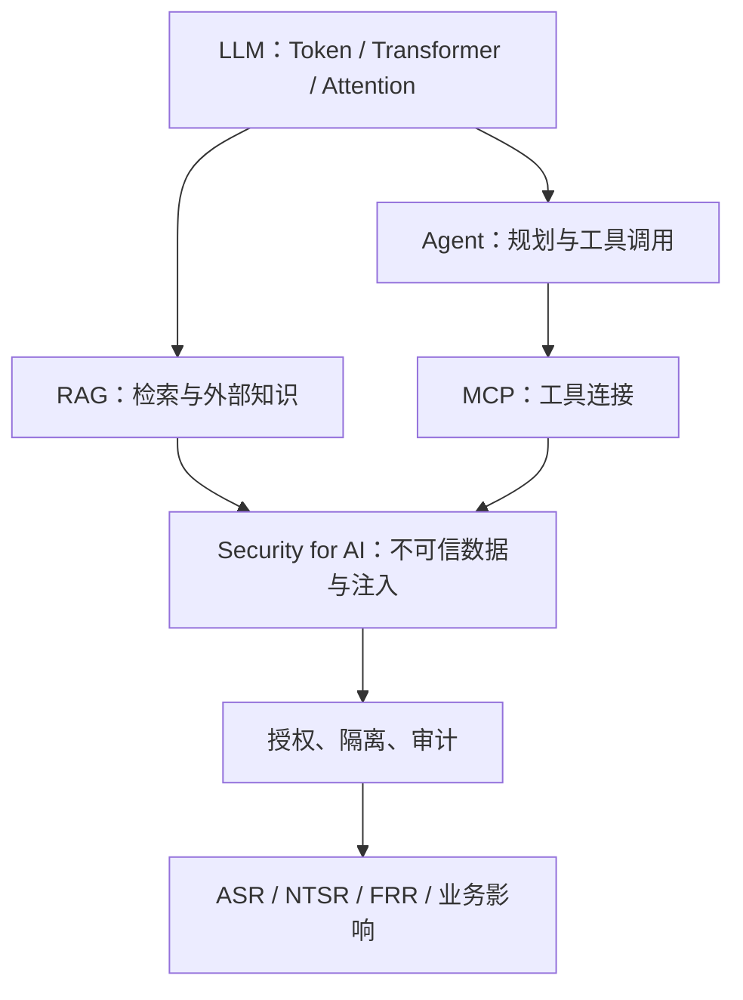

# AI Security Knowledge Base

面向 **Security for AI / AI for Security** 的知识串联仓库。按「机制 → 架构 → 信任边界 → 风险 → 防护 → 测试证据 → 企业落地」整理已学知识；每轮复盘一个主题，不以复盘代替验收。

## 知识链路

## 已整理主题

1. [LLM 的本质与一次模型调用的完整链路](01-LLM-Basics/01-llm-call-chain.md)

## 后续主题

- Token、Embedding、Transformer 与 Attention
- RAG 检索到上下文，以及检索结果的信任边界
- Agent、Function Calling 与 MCP 的关系
- Prompt Injection、RAG Poisoning 与执行风险
- AI 安全防护、回归测试和企业落地

## 关联资料

- [实验代码](https://github.com/glockie029/AI_security)
- [Notion 学习路线](https://app.notion.com/p/3f329b7115128191b65cf7d7e8067c0f?pvs=204)

**约定：** 真实测试与模拟推演必须区分；未运行的测试不填虚构结果。